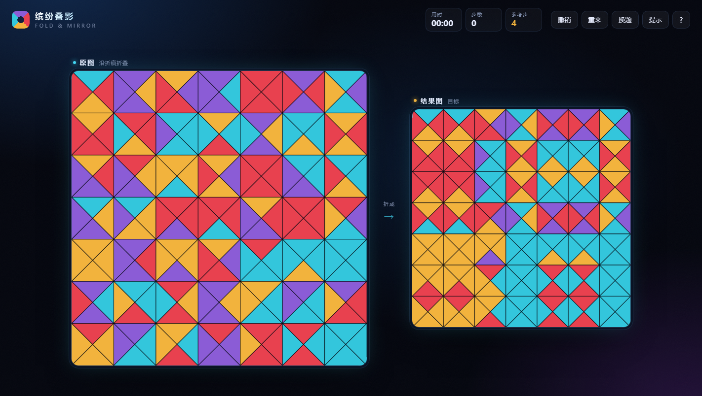
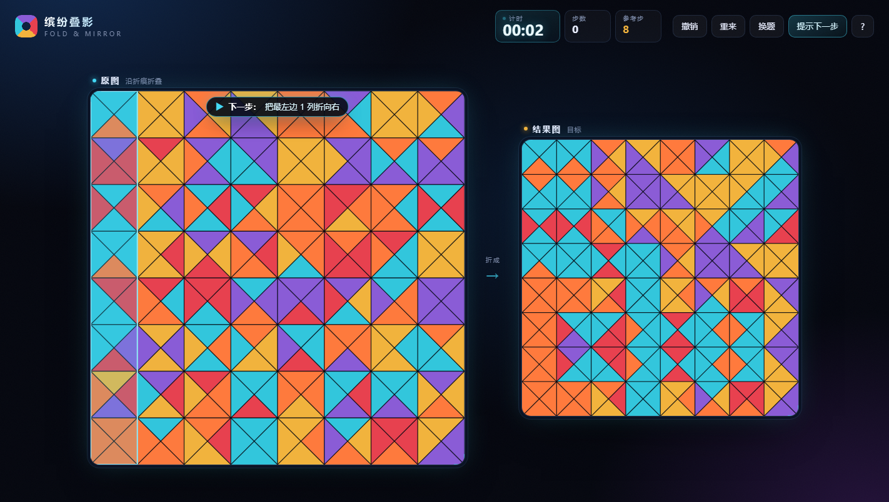

# 缤纷叠影 · 折叠还原

一个纯前端的空间推理小游戏，玩法参考《最强大脑》同款项目「缤纷叠影」：
**一整张三角彩纸，沿折痕把左边的「原图」折成右边的「结果图」。**

没有任何依赖、不需要构建，双击 `index.html` 就能玩，也可以直接丢到 GitHub Pages / Vercel / 任意静态托管上。



点「提示下一步」时，会把不折的部分整体压暗、只留要折的那一块保持原色：



---

## 玩法

盘面是一整张彩纸：方格线把纸分成 n×n 格，每格再用两条对角线切成 **4 个三角色块**
（上 / 右 / 下 / 左）。整张纸是四类折痕拼起来的三角网格，所以**横、竖、斜哪个方向都能折**：

| 折痕 | 折线 | 折走的部分 |
| --- | --- | --- |
| 竖折 | `x = c` | 左边或右边的矩形条 |
| 横折 | `y = c` | 上边或下边的矩形条 |
| 斜折 ↘ | `x − y = c` | 某一角上的三角形 |
| 斜折 ↙ | `x + y = c` | 某一角上的三角形 |

| 规则 | 说明 |
| --- | --- |
| 预览 | 鼠标移到任意一条折痕上，会亮起「要被折走的那一块」 |
| 方向 | 只能把**较少的一侧**折过去；两侧正好等大时（主对角线、副对角线）**正反两向都能折**，折哪一半由鼠标落在折线哪一侧决定 |
| 镜像 | 翻面时三角色块按折痕**镜像**，覆盖对面原有的颜色 |
| 底层 | 被折走的一侧露出下一张同款彩纸，所以**看起来不变** |
| 通关 | 盘面颜色与结果图完全一致即通关，不限步数 |

计分：用时越短、步数越接近「参考步」越好，三星条件为 `步数 ≤ 参考步`。

### 操作

- 鼠标移上折痕 → 预览，点击 → 折叠；斜折的点击区是那条 45° 斜线
- **对角线的两个方向**：主对角线 `x−y=0`、副对角线 `x+y=n` 把纸分成两个等大的直角三角形，
  所以两个方向都合法（右下角折到左上、左上角折到右下…）。把鼠标放在折线的**任一侧**，
  预览就会切成那一侧的三角形，点下去就把它折到对面；移动鼠标跨过折线时预览会实时跟着切换
- 键盘：`Z` 撤销 · `R` 重来 · `H` 提示
- **计时**：左上角计时牌从开局起一路累加，**不限时**，通关时结算用时
- **提示下一步**：高亮这一步该折的折痕，并在盘面上方用一句话说明怎么折
  （「把最上边 3 行折向下」「把右下角的三角形折向左上」…）。
  提示优先沿出题解法给下一步，所以再长的解法也能一直提示；
  走偏了会先做 3 层搜索，能折到终点或折回原路就给那一步
- **折错了要撤销**：折叠不可逆 —— 翻过去的颜色会盖住对面，没法「展开还原」。
  所以一旦折离原路，提示不会再瞎给一步，而是告诉你「先撤销 N 下回原路」，并把撤销按钮点亮

### 难度

| 难度 | 盘面 | 颜色 | 参考步 |
| --- | --- | --- | --- |
| 入门 | 5×5 | 3 | 2 |
| 初级 | 6×6 | 4 | 3 |
| 中级 | 7×7 | 4 | 5 |
| 高级 | 8×8 | 5 | 7 |
| 挑战 | 9×9 | 6 | 9 |

题目由程序实时生成：先随机生成一张彩纸，再随机折叠 k 次，把折完的结果当作「结果图」。
所以每一道题**一定可解**，而且无限出题、不会重复。

生成后会做一遍**冗余步剪枝**：折叠是「覆盖」操作，后折的一侧会把前一次折出来的颜色盖掉，
于是有些步等于白折。程序逐条试着删掉每一步，删完还能到同一结果的就真删，
剩下的才算进「参考步」。剪完还会验两件事：每一步都必须真的改变盘面（净变化不少于该折面积的一半），
原图与结果图的差异不少于盘面的 28%。所以参考步基本等于这道题的最少必要步数，不会再出现
「标 4 步、其实折 2 步就够了」的情况。


---

## 本地运行

直接双击 `index.html` 即可（全部逻辑内联，`file://` 也能跑）。

想用本地服务器：

```bash
# 任选一种
python -m http.server 8080
npx serve .
```

然后打开 <http://127.0.0.1:8080>。

---

## 部署到 GitHub Pages

### 1. 建仓库并推送

当前仓库：<https://github.com/dongmuyunanfeng/little-game>，默认分支 `master`。

如果代码还没推上去：GitHub 网页 **New repository** → 名字填 `little-game`，可见性选 **Public**
（免费版 Pages 只能发布公开仓库），**不要**勾「Add a README file」，然后：

```bash
cd binfen-dieying
git remote add origin https://github.com/dongmuyunanfeng/little-game.git
git push -u origin master
```

想改成 `main` 分支就先 `git branch -M main` 再 `git push -u origin main`，
然后在 GitHub 仓库 Settings → General → Default branch 里把默认分支切到 `main`。

> 推送时如果用账号密码会被拒。GitHub 现在只认 **Personal Access Token**：
> 头像 → Settings → Developer settings → Personal access tokens → Tokens (classic) →
> Generate new token，勾 `repo`，把生成的 `ghp_xxx` 当密码粘贴。
> 更省事的方式是用 GitHub Desktop 或 VS Code 登录一次，凭据会被记住。

### 2. 打开 Pages

仓库 → **Settings** → 左侧 **Pages**：

- **Source** 选 `Deploy from a branch`
- **Branch** 选 `master`（和仓库实际分支名一致，别选成不存在的 `main`），目录选 `/ (root)`
- 点 **Save**

等 1 分钟左右，访问：

```
https://dongmuyunanfeng.github.io/little-game/
```

> 仓库里已经放了 `.nojekyll`，可以跳过 Jekyll 处理，静态文件原样发布。
> 返回 404 且提示 "There isn't a GitHub Pages site here" 就是这步还没做或分支选错了。

### 3. 绑定自己的域名

先选一种，**强烈建议用子域名**（如 `game.example.com`），一条 CNAME 就完事：

| 方案 | 访问地址 | 需要配的记录 |
| --- | --- | --- |
| 子域名（推荐） | `game.example.com` | 1 条 CNAME |
| 根域名 | `example.com` | 4 条 A 记录 |

#### 3.1 华为云域名（云解析 DNS）怎么填

控制台 → **云解析服务 DNS** → **公网解析** → 点你的域名 → **添加记录集**：

| 字段 | 子域名方案 | 根域名方案 |
| --- | --- | --- |
| 记录类型 | `CNAME` | `A` |
| 主机记录 | `game`（**只写前缀**，不要写全域名） | `@` |
| 记录值 | `dongmuyunanfeng.github.io` | 依次添加 4 条：`185.199.108.153`、`185.199.109.153`、`185.199.110.153`、`185.199.111.153` |
| TTL | `300`（先小一点，方便改错后快速生效） | `300` |

几个容易填错的地方：

- **记录值那栏填的是 GitHub 的地址**（`你的用户名.github.io`），不是自己的域名；
  它形如 `example.com` 只是因为它就是个域名，别被输入框里的示例误导。
- 记录值不要带 `https://`、不要带末尾斜杠、不要带端口、末尾不加点。
- 主机记录填 `game`，最终域名自动拼成 `game.你的域名.com`；填成完整域名会报错。
- CNAME 记录和 A 记录**不能同名共存**；同一个子域名只能有一条 CNAME。
- 华为云域名必须完成**实名认证**，否则解析会被 `serverHold` 暂停，怎么等都访问不了。

#### 3.2 回填到 GitHub

回到仓库 **Settings → Pages → Custom domain**，填 `game.example.com` → **Save**。

GitHub 会自动在仓库根目录生成一个 `CNAME` 文件（也可以自己手写：把 `CNAME.sample`
复制成 `CNAME`，里面**只放一行域名**，不要有多余空行或 `https://`）。
两者内容必须和 DNS 里配的域名完全一致，否则会 404 或证书签发失败。

DNS 检查变绿后勾选 **Enforce HTTPS**（证书由 GitHub 自动签发，通常几分钟到几小时）。

生效后直接访问 `https://game.example.com` 就是游戏本体，不带任何路径。

> 备案：域名解析指向 GitHub（境外服务器）**不需要** ICP 备案；只有解析到境内服务器才需要。
>
> 注意：一旦在 Pages 里填了 Custom domain，`https://<用户名>.github.io/binfen-dieying/`
> 会 **301 跳转**到你的自定义域名，不再是一个独立入口。想两个地址都能用，就别设 Custom domain，
> 只在 DNS 里加 `CNAME`（GitHub 会自动跟随，但 HTTPS 证书只对 `github.io` 有效）。

> 其他托管方式同理：文件是纯静态的，Vercel / Netlify / Cloudflare Pages 直接拖进去就能上线，
> 绑定域名后在平台后台加一条 CNAME 即可。

---

## 项目结构

```
binfen-dieying/
├── index.html        # 游戏本体（HTML + CSS + JS 全部内联，无依赖）
├── README.md
├── LICENSE           # MIT
├── CNAME.sample      # 自定义域名模板
├── .nojekyll         # 关闭 GitHub Pages 的 Jekyll 处理
└── docs/
    ├── preview.png   # 示意图
    └── hint.png      # 提示效果
```

## 实现要点

- **折痕建模**：四类折线 `x=c`、`y=c`、`x−y=c`、`x+y=c`，`c` 取整数时折线正好落在网格的边上。
  每类折痕都取**面积较小的一侧**当折翼，所以折完彩纸一定还在盘面内。
- **等大折线的两个方向**：`x−y=0` 和 `x+y=n` 两侧面积一样大，折哪边都合法，因此各生成两个折痕对象
  （`dir` 相反）。UI 上它们共用一条点击条 —— 同一条线画两条会互相遮挡，只有上层那条点得到 ——
  由 `aim()` 用鼠标在盘面内的坐标算 `sideOf(折线)`，`>0` 折正侧、`<0` 折反侧、贴线时沿用上一次的方向。
  悬停跨过折线会实时切换预览（只有方向真的变了才重画高亮）。
- **折叠运算**：不写死方向分支，而是对每个三角取重心，判断它在折痕哪一侧，再把重心按折线
  **镜面反射**，反查落进了哪个三角 —— 这样竖折、横折、斜折共用同一套代码。映射只跟 `n` 和折痕
  有关，算一次就缓存，提示的 BFS 靠它做几千次推演也不卡。
- **动画**：把折翼连同折痕线克隆成一层 `flap`，绕折痕翻 180°。横竖折是 `rotateY/rotateX(180deg)`；
  斜折用旋转共轭 `rotate(±45deg) rotateY(180deg) rotate(∓45deg)`，等价于绕盘面内的 45° 轴翻折，
  落点与几何反射完全重合（实测误差 0px）。
- **响应式**：色块全部用百分比定位 + `clip-path` 切三角，网格线用 `viewBox` 为 `0 0 n n`
  的 SVG 叠加（`vector-effect: non-scaling-stroke` 保证线宽不随尺寸变化），缩放不重排。

## License

[MIT](LICENSE)
